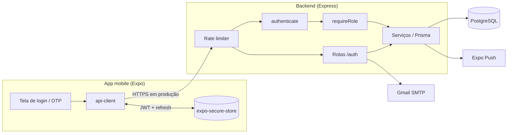
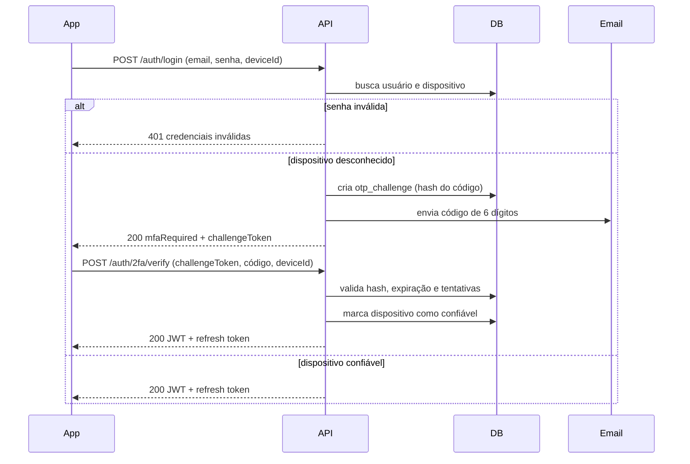

<!-- Created by AI. -->

# Arquitetura de autenticação e autorização

**Projeto:** Fiscalize Mobile
**Escopo:** aplicativo mobile (Expo/React Native) e backend (Express/Prisma)
**Versão:** 1.0
**Data:** 19/11/2026
**Documentos relacionados:** [Requisitos de Segurança - v2](Requisitos%20de%20Segurança%20-%20v2.md), [Auditoria dos requisitos](AUDITORIA-REQUISITOS-SEGURANCA.md), [Plano de Conformidade LGPD](PLANO-CONFORMIDADE-LGPD.md)

## 1. Objetivo

Este documento consolida, em um único lugar, o modelo técnico de autenticação e
de autorização efetivamente implementado no Fiscalize. Ele responde a três
perguntas:

1. **Quem é o usuário?** — como a identidade é provada (senha, dispositivo
   confiável, segundo fator).
2. **Qual sessão ele recebe?** — JWT de acesso, refresh token, expiração,
   rotação e revogação.
3. **O que ele pode fazer?** — papéis, hierarquia, escopo por órgão e regras de
   propriedade do recurso (object-level authorization).

O documento também registra as **lacunas conhecidas** para que a matriz de
acessos não descreva um sistema mais restritivo do que o código entrega.

## 2. Visão geral



**Componentes principais**

| Componente | Responsabilidade | Código |
|---|---|---|
| `SessionProvider` | Mantém a sessão, renova tokens, faz logout e guarda o dispositivo | `mobile/src/contexts/session-context.tsx` |
| `api-client` | Anexa o Bearer token, trata 401 e renova a sessão uma vez | `mobile/src/services/api-client.ts` |
| `authenticate` | Valida o JWT, consulta o usuário no banco e bloqueia inativos | `backend/src/middlewares/authMiddleware.ts` |
| `requireRole` | Aplica a hierarquia de papéis nas rotas | `backend/src/middlewares/requireRole.ts` |
| `authService` | Cadastro, login, MFA, refresh, logout, perfil e direitos | `backend/src/services/authService.ts` |
| `otpService` | Gera, envia e valida códigos temporários | `backend/src/services/otpService.ts` |

## 3. Identidades e perfis

O papel do usuário é o enum `perfil` do Prisma:

| Papel | Descrição | Tabela de perfil | Escopo natural |
|---|---|---|---|
| `Cidadao` | Registra e acompanha as próprias ocorrências | `cidadao` | Somente os próprios chamados |
| `Gestor` | Triagem, atendimento e indicadores do órgão | `gestor` (`orgaoid`) | Somente o próprio órgão |
| `Admin` | Administração de usuários, órgãos, categorias e regras | `admin` | Plataforma inteira |

O modelo é **RBAC híbrido**: papel + escopo por órgão + propriedade do recurso.
Apenas o papel não é suficiente para autorizar; o serviço também verifica o
vínculo do usuário com o registro.

### 3.1 Hierarquia de papéis

`backend/src/middlewares/requireRole.ts` define uma hierarquia:

```text
Admin  → Admin, Gestor, Cidadao
Gestor → Gestor, Cidadao
Cidadao → Cidadao
```

Consequências práticas:

- `requireRole(['Gestor'])` autoriza **Gestor e Admin**.
- `requireRole(['Cidadao'])` autoriza **Cidadao, Gestor e Admin** na camada de
  rota. O serviço ainda exige que o usuário tenha registro de cidadão para
  criar chamado, então Gestor/Admin recebem `403` na criação.
- `requireRole(['Admin'])` autoriza **apenas Admin**, porque nenhum outro papel
  inclui `Admin` na lista de permissões.

> A hierarquia está documentada e testada pelo comportamento das rotas, mas não
> há testes automatizados específicos para a matriz abaixo. Ver seção 9.

## 4. Autenticação

### 4.1 Cadastro

`POST /auth/register` é público, protegido por rate limit de autenticação
(10 requisições/minuto por IP).

Dados exigidos: nome, e-mail, senha, CPF, data de nascimento, endereço e
`privacyPolicyVersion`. O backend:

1. valida a política de senha (`backend/src/utils/passwordPolicy.ts`);
2. valida a idade mínima de 18 anos (`backend/src/utils/agePolicy.ts`);
3. grava `usuario`, `cidadao` e `consentimento_privacidade` na mesma transação
   (`backend/src/services/authService.ts`, `register`);
4. persiste a senha com **bcrypt, custo 10**, nunca em texto puro.

O cadastro não devolve sessão: o usuário faz login em seguida.

### 4.2 Login e confiança do dispositivo

`POST /auth/login` recebe `email`, `senha`, `deviceId` e `deviceName`.

1. Usuário inexistente, senha incorreta e usuário inativo recebem a mesma
   resposta genérica de credenciais inválidas (`401`/`403` sem enumeração).
2. Cinco falhas consecutivas bloqueiam a conta por **15 minutos** (`423`).
   O contador e o bloqueio ficam em `usuario.tentativas_login_falhas` e
   `usuario.bloqueado_ate`.
3. O `deviceId` é transformado em hash SHA-256 e comparado com
   `usuario_dispositivo` (`usuario_id + device_hash`).
4. **Dispositivo não confiável** → o backend cria um desafio OTP e responde
   `mfaRequired: true` com `challengeToken`; nenhum JWT é emitido ainda.
5. **Dispositivo confiável** → emite JWT de acesso + refresh token.



### 4.3 JWT de acesso

| Propriedade | Valor |
|---|---|
| Algoritmo | HS256 (padrão do `jsonwebtoken`) |
| Segredo | `JWT_SECRET` (obrigatório no ambiente) |
| Expiração padrão | `30m` (`JWT_EXPIRATION`) |
| Claims | `id`, `email`, `perfil` |
| Transporte | `Authorization: Bearer <token>` (ou cookie `token`) |
| Armazenamento no app | `expo-secure-store`, nunca AsyncStorage |

O middleware `authenticate` faz `jwt.verify`, consulta o usuário no banco a cada
requisição e rejeita:

- token ausente (`401`);
- token expirado (`401`);
- token inválido (`401`);
- token na blocklist de logout (`401`);
- usuário inexistente (`401`);
- usuário com status diferente de `Ativo` (`403`).

A consulta ao banco a cada requisição é deliberada: desativar um usuário passa a
valer imediatamente, sem esperar o JWT expirar.

### 4.4 Refresh token e rotação

| Propriedade | Valor |
|---|---|
| Formato | 32 bytes aleatórios em base64url |
| Persistência | apenas o hash SHA-256 em `refresh_token.token_hash` |
| Expiração | 30 dias (`REFRESH_TOKEN_EXPIRATION_DAYS`) |
| Rotação | a cada `POST /auth/refresh`, o token antigo é revogado e um novo é criado |
| Reutilização | token já revogado revoga **toda** a família de tokens do usuário |
| Substituição | `replaced_by` aponta para o token novo |

O cliente renova automaticamente uma vez após `401` e repete a requisição
original (`mobile/src/services/api-client.ts`). Se a renovação falhar, a sessão
é encerrada.

### 4.5 Logout

`POST /auth/logout` exige autenticação, revoga todos os refresh tokens ativos do
usuário e adiciona o JWT atual a uma blocklist em memória até a expiração.

> **Limitação:** a blocklist é um `Set` no processo
> (`backend/src/services/authService.ts`). Com mais de uma instância do backend,
> o logout pode não invalidar o JWT em todas elas. O comentário no código já
> indica Redis como destino de produção.

### 4.6 MFA / segundo fator

O segundo fator implementado é **OTP por e-mail**. SMS e TOTP não estão
habilitados.

| Propriedade | Valor |
|---|---|
| Formato | 6 dígitos |
| Expiração | 5 minutos |
| Reenvio | cooldown de 60 segundos |
| Tentativas | 5; ao esgotar, o desafio é consumido |
| Persistência | `otp_challenge` com hashes do desafio e do código |
| Destino | e-mail do usuário, via Gmail SMTP |
| Uso | login em dispositivo novo e ações críticas |

**Ações críticas que exigem OTP** (`consumeMfaVerification`):

| Ação | Rota | `action` |
|---|---|---|
| Trocar senha | `PATCH /auth/me/password` | `password` |
| Exportar dados pessoais | `GET/POST /auth/me/export` | `export` |
| Excluir conta | `DELETE /auth/me` | `delete` |
| Anonimizar dados | `PATCH /auth/me/anonymization` | `anonymization` |

O fluxo é: `POST /auth/2fa/request-critical` → código por e-mail →
`POST /auth/2fa/verify` → `verificationToken` de uso único, vinculado ao usuário
e à ação → envio do `mfaToken` na operação crítica.

**Não exigem OTP hoje:** alterações administrativas (mudança de papel,
desativação de usuário, criação de regras). Ver lacunas.

### 4.7 Política de senha

Implementada no backend e espelhada no mobile:

- mínimo de 8 caracteres;
- pelo menos uma letra minúscula;
- pelo menos uma letra maiúscula;
- pelo menos um número;
- pelo menos um caractere especial.

O hash é bcrypt com custo 10. A senha nunca é devolvida em `GET /auth/me`,
exportações ou logs.

## 5. Autorização

### 5.1 Cadeia de middlewares

```text
rate limit → authenticate → requireRole → controller → service (ownership/tenant)
```

A ordem importa: o rate limit roda antes da autenticação para conter força bruta
e abuso; `authenticate` popula `req.user`; `requireRole` aplica o papel; o
serviço aplica a regra de negócio e o escopo do registro.

### 5.2 Escopo por recurso

| Recurso | Regra implementada |
|---|---|
| Chamados do cidadão | `cidadaoid = req.user.id` na listagem, no detalhe e na edição |
| Chamados do gestor | `orgaoid` do gestor na fila, no dashboard, no detalhe, em aceitar/transferir e na atualização de status |
| Chamados do admin | Sem filtro de órgão; visão de plataforma |
| Métricas | Gestor vê o próprio órgão; Admin vê a plataforma |
| Notificações | Sempre `usuarioid = req.user.id` |
| Consentimentos | Sempre `usuario_id = req.user.id` |
| Órgãos | Leitura por Admin/Gestor; escrita apenas Admin |

### 5.3 Matriz de acesso por rota

Legenda: **P** = público; **C** = Cidadao; **G** = Gestor; **A** = Admin;
**—** = bloqueado. “Próprio” indica verificação de propriedade no serviço.

| Rota / grupo | P | C | G | A | Regra efetiva |
|---|:--:|:--:|:--:|:--:|---|
| `POST /auth/register` | ✅ | — | — | — | Público, rate limit 10/min |
| `POST /auth/login` | ✅ | — | — | — | Público, rate limit 10/min |
| `POST /auth/2fa/verify` | ✅ | — | — | — | Exige `challengeToken` válido |
| `POST /auth/refresh` | ✅ | — | — | — | Exige refresh token válido |
| `POST /auth/2fa/request-critical` | — | ✅ | ✅ | ✅ | Autenticado; código para ação crítica |
| `POST /auth/logout` | — | ✅ | ✅ | ✅ | Autenticado; revoga refresh tokens |
| `GET /auth/me` | — | ✅ | ✅ | ✅ | Próprio usuário |
| `PUT /auth/me` | — | ✅ | ✅ | ✅ | Próprio usuário |
| `PATCH /auth/me/password` | — | ✅ | ✅ | ✅ | Próprio + OTP `password` |
| `GET/POST /auth/me/export` | — | ✅ | ✅ | ✅ | Próprio + OTP `export` |
| `DELETE /auth/me` | — | ✅ | ✅ | ✅ | Próprio + senha + OTP `delete` |
| `PATCH /auth/me/anonymization` | — | ✅ | ✅ | ✅ | Próprio + OTP `anonymization` |
| `GET /categories` | — | ✅ | ✅ | ✅ | Autenticado |
| `GET /demands` | — | ✅ | ✅ | ✅ | C: próprios; G/A: todos (ver lacuna L1) |
| `GET /demands/public` | ✅ | — | — | — | Público, projeção anonimizada |
| `POST /demands` | — | ✅ | ⚠️ | ⚠️ | Guard amplo; serviço exige perfil Cidadao |
| `GET /demands/:id` | — | ✅ | ✅ | ✅ | C: próprio; G/A: qualquer (L1) |
| `PUT /demands/:id` | — | ✅ | ⚠️ | ⚠️ | Serviço exige ser o dono do chamado |
| `PATCH /demands/:id/status` | — | — | ✅ | ✅ | G/A: sem validação de órgão (L2) |
| `DELETE /demands/:id` | — | ✅ | ✅ | ✅ | Dono, ou qualquer G/A (soft delete) |
| `GET /demands/organizations` | — | ✅ | ✅ | ✅ | C: próprios; G/A: todos |
| `/gestor/*` | — | — | ✅ | ✅ | G: próprio órgão; A: plataforma |
| `/metrics/*` | — | — | ✅ | ✅ | G: próprio órgão; A: plataforma |
| `/notifications/*` | — | ✅ | ✅ | ✅ | Sempre o próprio usuário |
| `GET /admin/organs` | — | — | ✅ | ✅ | Leitura de órgãos |
| `POST/PUT/PATCH/DELETE /admin/organs` | — | — | — | ✅ | Escrita apenas Admin |
| `/admin/users/*` | — | — | — | ✅ | Admin; não pode alterar o próprio papel |
| `/admin/routing-rules/*` | — | — | — | ✅ | Admin |
| `GET /admin/audit-logs` | — | — | — | ✅ | Admin |
| `GET /dashboard/etl/*` | ✅ | — | — | — | Sem autenticação (L3) |
| `GET /health`, `/docs`, `/docs.json` | ✅ | — | — | — | Operação/documentação |

⚠️ = passa no guard de papel, mas o serviço bloqueia ou restringe por perfil,
propriedade ou vínculo.

### 5.4 Regras de negócio relevantes

- **Criação de chamado:** o serviço busca `cidadao` pelo `id`; sem registro, a
  resposta é `403` mesmo que o papel passe no guard.
- **Edição de chamado:** somente o cidadão dono. Gestor/Admin não editam o
  conteúdo do chamado; eles atuam por status, aceite e transferência.
- **Exclusão de chamado:** é um *soft delete* (`excluidoem`, status `Fechado`),
  preservando o histórico e a prestação de contas.
- **Alteração de papel:** um Admin não pode alterar o próprio papel; pode
  promover outro usuário a Admin. A criação de Admin por `/admin/users` é
  bloqueada de propósito.
- **Usuário inativo:** o `authenticate` bloqueia qualquer requisição, mesmo com
  JWT ainda válido.

## 6. Tabelas de identidade e sessão

| Tabela | Conteúdo | Dados pessoais? |
|---|---|---|
| `usuario` | nome, e-mail, hash de senha, perfil, status, contadores de bloqueio | Sim |
| `cidadao` | CPF, data de nascimento, endereço, flag de anonimização | Sim |
| `gestor` | vínculo com órgão, departamento, telefone | Sim |
| `admin` | nível de acesso e escopo (hoje não usados na autorização) | Sim (metadado) |
| `refresh_token` | hash do token, expiração, revogação, substituição | Não (pseudônimo) |
| `usuario_dispositivo` | hash do device ID, nome, push token, confiança | Sim (identificador) |
| `otp_challenge` | hashes de desafio/código, finalidade, tentativas, expiração | Não (hash) |
| `consentimento_privacidade` | versão, documento, origem, data do aceite | Sim (metadado) |
| `audit_logs` | ação administrativa, entidade, autor, metadados | Sim (autor) |

## 7. Controles de proteção da autenticação

| Controle | Implementação |
|---|---|
| Rate limit geral | 100 req/min/IP |
| Rate limit de autenticação | 10 req/min/IP |
| Rate limit de OTP | 5 req/min/IP |
| Rate limit de criação de chamado | 10 req/min/IP |
| Bloqueio de conta | 5 falhas → 15 minutos |
| Hash de senha | bcrypt custo 10 |
| Hash de refresh token | SHA-256 |
| Hash de código OTP | SHA-256 |
| Hash de dispositivo | SHA-256 |
| Expiração de JWT | 30 minutos |
| Expiração de refresh | 30 dias |
| Expiração de OTP | 5 minutos |
| Cooldown de OTP | 60 segundos |
| Tentativas de OTP | 5 |
| Revogação em massa | Refresh tokens revogados em caso de reuso ou logout |
| Logs de segurança | Estruturados e mascarados no branch `feature/rnf-sec-05-13-15-16` (ainda não no commit do submódulo) |
| Auditoria administrativa | `audit_logs` para papel, ativação, órgãos e regras |

## 8. Ameaças e mitigações

| Ameaça | Vetor | Mitigação atual | Lacuna |
|---|---|---|---|
| Força bruta de senha | `/auth/login` | Rate limit + bloqueio de 5 tentativas | Sem CAPTCHA; bloqueio por conta pode ser usado para DoS direcionado |
| Enumeração de usuários | Login/cadastro | Mensagens genéricas | Cadastro ainda revela e-mail existente (`409`) |
| Roubo de token | dispositivo comprometido | SecureStore + expiração curta + rotação | Sem *binding* do JWT ao dispositivo |
| Reuso de refresh token | vazamento de token | Detecção e revogação da família | — |
| Reuso de OTP | interceptação de e-mail | Hash, expiração, uso único, 5 tentativas | E-mail é canal externo (Gmail) |
| Escalada de privilégio | alteração de papel | Somente Admin; auditoria | Promoção a Admin não exige OTP |
| Acesso a recurso de outro usuário (IDOR/BOLA) | IDs previsíveis/Manipulados | Ownership no cidadão e escopo de órgão no gestor | `/demands` e `/demands/:id` não filtram Gestor por órgão; `PATCH /demands/:id/status` não valida órgão |
| Sessão após logout em múltiplas instâncias | blocklist local | Blocklist em memória | Migrar para Redis |
| Sequestro de sessão por XSS | app mobile | Sem DOM/cookies no app | Cookie `token` existe no backend para o front web |
| Acesso a dados agregados | `/dashboard/etl/*` | Dados agregados | Endpoint público; avaliar se deve exigir autenticação |

## 9. Lacunas e recomendações

| ID | Lacuna | Risco | Recomendação | Prioridade |
|---|---|---|---|---|
| L1 | `GET /demands` e `GET /demands/:id` não restringem Gestor ao próprio órgão | Gestor lê chamados de outros órgãos | Aplicar `orgaoid` do gestor no serviço, como já ocorre em `/gestor/*` | Alta |
| L2 | `PATCH /demands/:id/status` não valida se o chamado pertence ao órgão do Gestor | Gestor altera status de chamado alheio | Reutilizar a checagem de `/gestor/chamados/:id/status` | Alta |
| L3 | `/dashboard/etl/*` é público | Exposição de agregados por bairro | Exigir autenticação ou documentar a decisão de transparência | Média |
| L4 | Blocklist de logout em memória | Logout parcial em múltiplas instâncias | Usar Redis com TTL igual ao `exp` do JWT | Alta |
| L5 | Ações administrativas não exigem OTP | Admin comprometido altera papéis | Exigir MFA crítico em mudança de papel/desativação | Média |
| L6 | `admin.nivel_acesso` e `permissao_escopo` não são usados | Campo sugere controle que não existe | Remover ou implementar escopo granular | Média |
| L7 | Não há fluxo de “esqueci minha senha” | Usuário perde acesso | Criar recuperação com token de uso único e expiração curta | Média |
| L8 | Não há gestão de dispositivos confiáveis | Dispositivo perdido continua confiável | Tela para listar/revogar dispositivos | Média |
| L9 | Sem testes automatizados da matriz de acesso | Regressão silenciosa de autorização | Testes de API por papel e por propriedade, incluindo negativos (401/403) | Alta |
| L10 | Sem *binding* do JWT ao dispositivo | Token roubado vale até expirar | Claim de dispositivo ou prova de posse no refresh | Baixa |
| L11 | Sem CAPTCHA no login | Automação distribuída | Avaliar após volume real de abuso | Baixa |

## 10. Referências de código

- `backend/src/middlewares/authMiddleware.ts`
- `backend/src/middlewares/requireRole.ts`
- `backend/src/services/authService.ts`
- `backend/src/services/otpService.ts`
- `backend/src/services/adminService.ts`
- `backend/src/services/demandService.ts`
- `backend/src/controllers/gestorController.ts`
- `backend/src/controllers/metricsController.ts`
- `backend/src/routes/authRoutes.ts`
- `backend/src/routes/demandRoutes.ts`
- `backend/src/routes/adminRoutes.ts`
- `backend/prisma/schema.prisma`
- `mobile/src/contexts/session-context.tsx`
- `mobile/src/services/api-client.ts`
- `mobile/src/services/device-service.ts`
- `mobile/src/views/otp-verification-view.tsx`

## 11. Histórico

| Versão | Data | Alteração |
|---|---|---|
| 1.0 | 19/11/2026 | Consolidação do modelo de autenticação, matriz RBAC e lacunas identificadas no código. |
