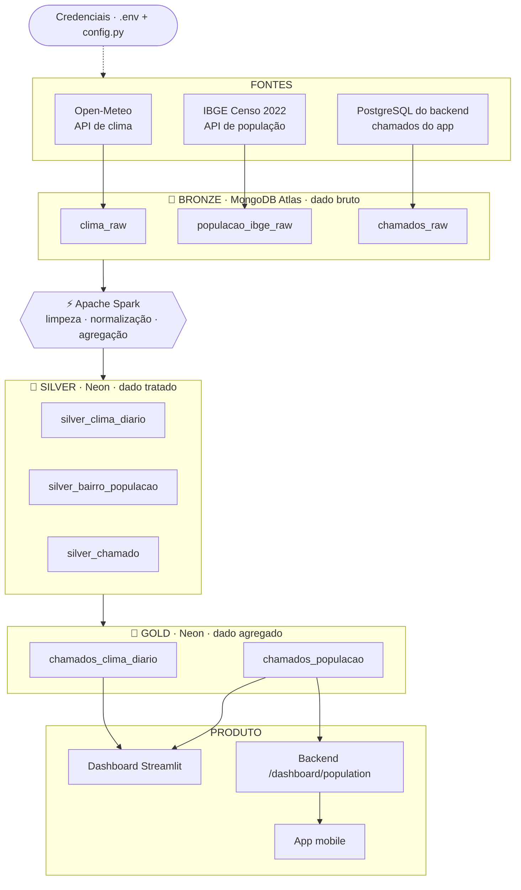
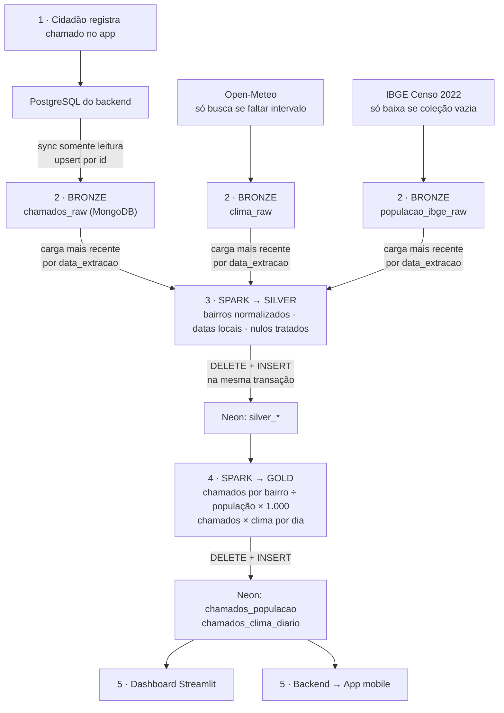
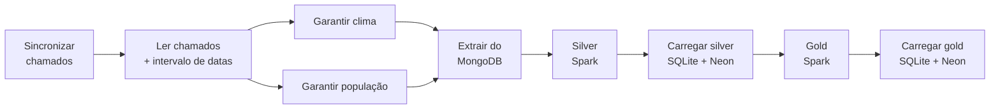
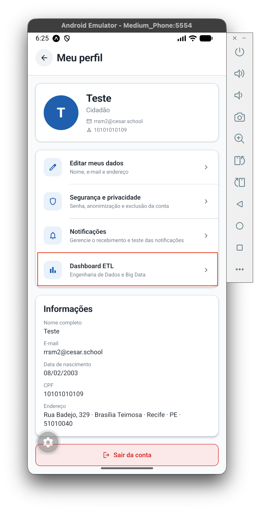
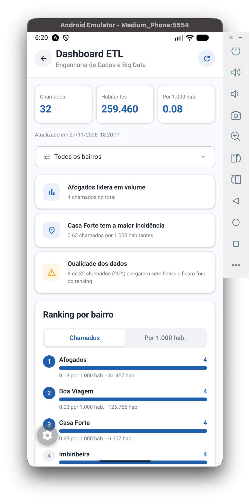
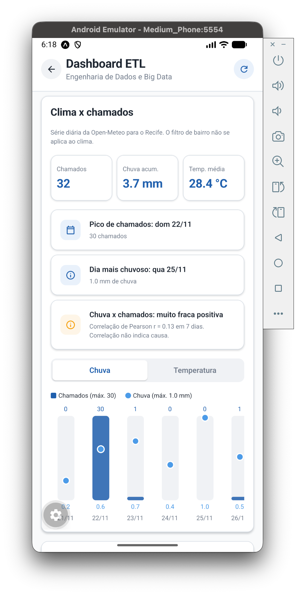
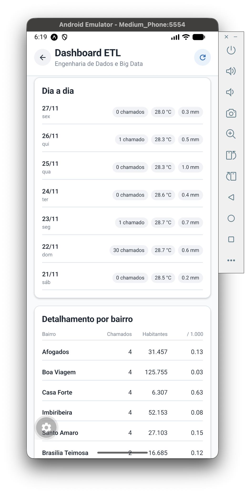

# Fiscalize — Produto baseado em dados

> Chamados urbanos do Recife enriquecidos com **clima** (Open-Meteo) e **população** (IBGE), tratados por uma pipeline Bronze → Silver → Gold e entregues em dashboards web e mobile.

---

## 1. O produto

| | |
|---|---|
| **Produto** | Dashboard ETL (Streamlit web) + tela **Dashboard ETL** no app mobile |
| **Pergunta que responde** | Quais bairros concentram mais chamados *por habitante*? Chuva e calor influenciam os chamados? |
| **Fonte do produto** | Banco montado pela pipeline (Neon). **Nunca a API direto.** |

---

## 2. Arquitetura



---

## 3. Fluxo do dado — do início ao dashboard



### O que acontece em cada etapa

| # | Etapa | Entrada | Saída | Tratamento-chave |
|---|---|---|---|---|
| 1 | **Sync** | PostgreSQL do backend | `chamados_raw` | Upsert por `id`; coordenada `(0,0)` vira "sem coordenada" |
| 2 | **Extract** | Open-Meteo / IBGE | `clima_raw` / `populacao_ibge_raw` | Carimbo `data_extracao`; chama a API só quando necessário |
| 3 | **Silver** (Spark) | Bronze | `silver_*` | Bairro em maiúsculas, sem acento, espaços colapsados; `-`, `N/A`, `...` → nulo; chuva `0` preservada |
| 4 | **Gold** (Spark) | Silver | `chamados_*` | `chamados_por_1000`; cruzamento por data local de Recife; sem bairro → `NAO INFORMADO` |
| 5 | **Consumo** | Gold (Neon) | Dashboards | Lê somente o banco |

---

## 4. Checklist de requisitos

| Requisito | Status | Como |
|---|:-:|---|
| Dados vêm de **APIs públicas** | ✅ | Open-Meteo (clima) e IBGE (população) |
| Passam pela **pipeline do grupo** | ✅ | `flow_etl.py` |
| Produto lê do **banco**, não da API | ✅ | Streamlit e backend consultam as tabelas gold no Neon |
| Web **ou** mobile | ✅ | Os dois: Streamlit + app mobile |
| **Bronze** (bruto no MongoDB) | ✅ | `chamados_raw`, `clima_raw`, `populacao_ibge_raw` |
| **Silver** (tratado no Neon) | ✅ | `silver_chamado`, `silver_clima_diario`, `silver_bairro_populacao` |
| **Gold** (agregado para o produto) | ✅ | `chamados_populacao`, `chamados_clima_diario`, `chamados_clima` |
| **Cargas idempotentes** | ✅ | Ver seção 5 |
| **Transformação com Spark** | ✅ | `src/spark_transform.py` |
| **Orquestração com Prefect** | ✅ | Flow + deployment agendado |
| **Credenciais fora do código** | ✅ | `.env` (não versionado) + `src/config.py` |

---

## 5. Idempotência — rodar de novo não duplica

| Camada | Mecanismo |
|---|---|
| Sync de chamados | `_id` = id do chamado → **upsert** |
| Bronze (APIs) | ID determinístico por snapshot + manifesto `_etl_raw_loads`. Mesmo conteúdo = nenhum documento novo; conteúdo diferente = novo snapshot (histórico preservado) |
| Silver / Gold no Neon | `DELETE` + `INSERT` **na mesma transação** (sem `DROP`/`TRUNCATE`) |

---

## 6. Orquestração — Prefect



- **Agendamento:** `serve_etl.py` → cron `0 3 * * *`, fuso `America/Recife`
- **Execução manual:** `python flow_etl.py`
- **Execução sem Spark/Prefect:** `python run_etl.py` (mesma lógica em Pandas)

---

## 7. Credenciais

```text
.env  (não versionado)          .env.example  (versionado, sem segredos)
   │                                  │
   └──► src/config.py ◄───────────────┘
              │
              └──► usado por sync, extract, load e flow
```

`MONGODB_URI` · `DATABASE_URL` (Neon) · `BACKEND_DATABASE_URL` (somente leitura)

Nenhum módulo lê variável de ambiente por conta própria. Tudo passa por `config.py`.

---

## 8. Como rodar e atualizar o dashboard no app

### Rodar a pipeline completa (ordem recomendada)

```bash
cd etl
python -m src.sync_chamados   # backend → MongoDB (chamados_raw)
python flow_etl.py            # bronze → silver → gold → Neon
```

### Agendado (Prefect, diário às 03:00)

```bash
python -m prefect server start   # terminal 1
python serve_etl.py              # terminal 2 (manter ativo)
```

### Atualização rápida: só chamados novos no app

```bash
cd etl
python -m src.sync_chamados
python -c "from run_etl import run_populacao; run_populacao()"
```

Depois, no app: **puxe a tela do Dashboard ETL para baixo** ou toque no ícone de refresh.

> ⚠️ Rodar **só** o `sync_chamados` **não** muda o app. O dashboard lê `chamados_populacao` no Neon, que só é regravada pelo ETL.

| Quero atualizar | Comando |
|---|---|
| Chamados no app (rápido) | `sync_chamados` + `run_populacao()` |
| Chamados + clima (completo) | `sync_chamados` + `flow_etl.py` |
| Dashboard web | `python -m streamlit run dashboard/app.py` |

---

## 9. Stack

| Camada | Tecnologia |
|---|---|
| Fontes | Open-Meteo · IBGE Censo 2022 · PostgreSQL (backend) |
| Bronze | MongoDB Atlas |
| Transformação | Apache Spark 4.0.1 (Java 17/21) |
| Silver / Gold | Neon (PostgreSQL) + SQLite local |
| Orquestração | Prefect |
| Produto | Streamlit · App mobile (via backend) |

---

## 10. Resultado — Dashboard ETL no app

Tela **Dashboard ETL** do app mobile, lendo as tabelas gold do Neon via backend.

<table>
<tr>
<td align="center"><b>1 · Localização</b></td>
<td align="center"><b>2 · Chamados × população</b></td>
<td align="center"><b>3 · Clima × chamados</b></td>
<td align="center"><b>4 · Dia a dia e bairros</b></td>
</tr>
<tr>
<td></td>
<td></td>
<td></td>
<td></td>
</tr>
</table>

| Tela | O que mostra | Gold de origem |
|---|---|---|
| 1 | KPIs (32 chamados · 259.460 hab. · 0,08 por 1.000 hab.), filtro por bairro, ranking, alerta de qualidade (25% sem bairro) | `chamados_populacao` |
| 2 | Chuva acumulada, temperatura média, pico de chamados, correlação chuva × chamados (r = 0,13), gráfico diário | `chamados_clima_diario` |
| 3 | Tabela dia a dia (chamados · °C · mm) e detalhamento por bairro | `chamados_clima_diario` · `chamados_populacao` |

> O dado do app (Open-Meteo + IBGE + chamados) chega via pipeline. O app só lê o Neon.


---

## 11. Limitações conhecidas

- O sync não remove chamados apagados no backend (soft-delete continua no bronze, na silver e no dashboard).
- Rodar só o sync **não** atualiza o dashboard. É preciso rodar a pipeline (ou a etapa de população).
- Clima de datas muito recentes pode ficar nulo até a Open-Meteo publicar o histórico.
