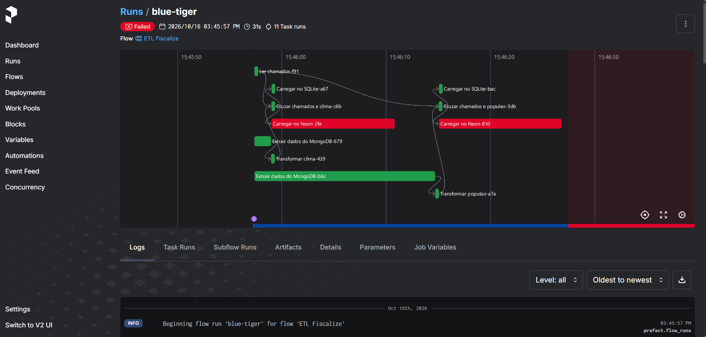

# Orquestração da Pipeline ETL com Prefect

## 1. Objetivo

Esta atividade tem como objetivo utilizar o **Prefect** para orquestrar a pipeline ETL do projeto Fiscalize. A orquestração organiza as etapas de extração, transformação e carregamento dos dados, respeitando suas dependências e permitindo acompanhar a execução, visualizar logs e identificar possíveis falhas.

O fluxo foi implementado no arquivo `etl/flow_etl.py`, utilizando *tasks* para representar as etapas da pipeline e um *flow* para coordenar sua execução.

## 2. Pré-requisitos

Antes de executar o projeto, é necessário ter instalado:

- Python 3.11 ou superior (testado com Python 3.14 e Prefect 3.8);
- Git, para clonar o repositório;
- Visual Studio Code ou outro editor de código;
- Acesso às bases de dados utilizadas pelo projeto, incluindo MongoDB e Neon PostgreSQL;
- Arquivo `.env` configurado com as variáveis de ambiente necessárias.

O SQLite é utilizado para o armazenamento local dos dados processados.

## 3. Obter o projeto

Caso o repositório ainda não esteja disponível na máquina, clone-o utilizando o terminal:

```powershell
git clone https://github.com/camilamta275/fiscalize-mobile.git
```

Entre na pasta do projeto e, em seguida, na pasta da pipeline ETL:

```powershell
cd fiscalize-mobile
cd etl
```

Se o repositório já estiver clonado, basta abrir o terminal na pasta `etl`.

## 4. Criar e ativar o ambiente virtual

O ambiente virtual permite instalar as dependências do projeto sem interferir nas demais instalações do Python.

No terminal do PowerShell, dentro da pasta `etl`, execute:

```powershell
python -m venv .venv
```

Ative o ambiente virtual:

```powershell
.\.venv\Scripts\Activate.ps1
```

Após a ativação, o terminal deverá apresentar `(.venv)` antes do caminho atual.

Caso o PowerShell bloqueie a ativação do ambiente virtual, verifique as políticas de execução configuradas no sistema. Como alternativa, também é possível ativar o ambiente pelo terminal do Prompt de Comando utilizando `.venv\Scripts\activate.bat`.

## 5. Instalar as dependências

Com o ambiente virtual ativado, atualize o instalador de pacotes e instale as dependências declaradas no arquivo `requirements.txt`:

```powershell
python -m pip install --upgrade pip
python -m pip install -r requirements.txt
```

O arquivo deve incluir o Prefect, as bibliotecas utilizadas pela pipeline e o driver PostgreSQL necessário à conexão com o Neon. Na configuração utilizada durante o desenvolvimento, o driver é `psycopg[binary]`.

Caso essa dependência ainda não esteja no arquivo, instale-a com:

```powershell
python -m pip install "psycopg[binary]"
```

É importante registrar essa dependência no `requirements.txt` para que outras pessoas consigam reproduzir a execução.

## 6. Configurar as variáveis de ambiente

Na pasta `etl`, crie um arquivo chamado `.env` com base no modelo `.env.example`, caso ele esteja disponível.

Esse arquivo deve conter as variáveis necessárias para acessar os bancos de dados. Entre elas, estão:

- `MONGODB_URI`: endereço de conexão com o MongoDB;
- `DATABASE_URL`: endereço de conexão com o banco PostgreSQL no Neon.

Os valores devem corresponder às credenciais e aos endereços fornecidos para o ambiente utilizado pelo projeto.

**Importante:** não compartilhe credenciais e não envie o arquivo `.env` ao GitHub. O arquivo deve ser excluído do controle de versão pelo `.gitignore`. No repositório, mantenha apenas o `.env.example`, sem senhas ou outros segredos reais.

## 7. Configurar e iniciar o servidor Prefect

O Prefect disponibiliza uma interface web para acompanhar os fluxos e as tarefas executadas.

Dentro da pasta `etl`, com o ambiente virtual ativado, configure o endereço local da API:

```powershell
python -m prefect config set PREFECT_API_URL="http://127.0.0.1:4200/api"
```

Em seguida, inicie o servidor:

```powershell
python -m prefect server start
```

Mantenha esse terminal aberto enquanto estiver utilizando o painel. Por padrão, a interface web fica disponível em:

[http://127.0.0.1:4200](http://127.0.0.1:4200)

Se aparecer uma mensagem informando que a porta 4200 já está em uso, pode haver um servidor Prefect em execução. Nesse caso, verifique se a interface já está acessível antes de tentar iniciar outro servidor.

## 8. Executar a pipeline orquestrada

Abra um segundo terminal no VS Code, entre na pasta `etl` e ative novamente o ambiente virtual:

```powershell
cd caminho\para\fiscalize-mobile\etl
.\.venv\Scripts\Activate.ps1
```

Se o terminal já estiver na pasta correta, não é necessário executar o comando `cd` novamente.

Execute o fluxo:

```powershell
python flow_etl.py
```

O Prefect iniciará a execução do fluxo `ETL Fiscalize`, registrando o estado de cada tarefa e exibindo os logs no terminal.

Ao final, uma execução concluída com sucesso deverá apresentar uma mensagem semelhante a:

```text
Flow run 'nome-da-execucao' - Finished in state Completed()
```

O nome da execução pode variar a cada tentativa.

### 8.1. Opções de execução

| Comando | O que faz |
|---|---|
| `python flow_etl.py` | Executa a pipeline usando os dados brutos já armazenados no MongoDB. |
| `python flow_etl.py --api` | Antes de transformar, busca novamente os dados nas APIs (Open-Meteo e IBGE) e atualiza o MongoDB. |
| `python flow_etl.py --sem-neon` | Executa a pipeline gravando os resultados apenas no SQLite, sem a carga no Neon. Útil quando não há acesso ao banco PostgreSQL. |
| `python flow_etl.py --simular-falha` | Lê uma coleção inexistente no lugar de `clima_raw`, para demonstrar como o Prefect registra uma falha e as novas tentativas. |
| `python flow_etl.py --serve` | Cria o deployment `etl-fiscalize-agendado`, que executa a pipeline automaticamente a cada hora. O terminal deve permanecer aberto. |

Com o deployment ativo, também é possível disparar uma execução pelo próprio painel, em **Deployments > etl-fiscalize-agendado > Run**, informando os parâmetros do flow.

## 9. Como a pipeline funciona

O fluxo possui dois ramos independentes, um de clima e outro de população, que são executados em paralelo. Dentro de cada ramo, as etapas seguem uma ordem fixa:

```text
                  ┌─> [Extrair clima da API]* ─> Extrair clima_raw ─> Transformar clima ─> Cruzar chamados e clima ─┬─> Carregar no SQLite
Ler chamados ─────┤                                                                                                 └─> Carregar no Neon
                  └─> [Extrair população da API]* ─> Extrair populacao_ibge_raw ─> Transformar população ─> Cruzar chamados e população ─┬─> Carregar no SQLite
                                                                                                                                        └─> Carregar no Neon
* apenas com --api
```

As dependências são definidas pela passagem de dados entre as tasks: uma task só começa quando as tasks das quais recebe dados terminam com sucesso. A leitura do MongoDB depende da extração das APIs por meio do parâmetro `wait_for`. Se uma etapa falhar, as etapas seguintes do mesmo ramo não são executadas, mas o outro ramo continua normalmente.

O fluxo foi organizado para processar os dados dos chamados e combiná-los com informações climáticas e populacionais.

### 9.1. Leitura dos chamados

A tarefa `ler_chamados` lê os chamados armazenados no arquivo `data/chamados.json`. Esses dados servem como base para os cruzamentos posteriores.

### 9.2. Extração dos dados

A tarefa `extrair_mongo` consulta as coleções do MongoDB utilizadas pela pipeline:

- `clima_raw`: dados climáticos;
- `populacao_ibge_raw`: dados populacionais.

Por padrão, o fluxo utiliza os dados brutos já armazenados no MongoDB. Com a opção `--api` (parâmetro `carregar_da_api=True`), as tasks `extrair_clima_api` e `extrair_populacao_api` buscam os dados na Open-Meteo e no IBGE e atualizam essas coleções antes da leitura.

As tasks de extração e de carga no Neon dependem de serviços externos. Por isso, foram configuradas com novas tentativas automáticas (`retries`) em caso de falha.

### 9.3. Transformação dos dados

Os dados são preparados para utilização nas próximas etapas:

- `transformar_clima`: organiza as informações climáticas, como data, temperatura e precipitação;
- `transformar_populacao`: seleciona e organiza as informações de população por bairro.

Essa etapa padroniza os dados antes dos cruzamentos.

### 9.4. Cruzamento dos dados

Os chamados são combinados com as informações transformadas:

- `cruzar_clima`: relaciona os chamados às informações climáticas correspondentes às suas datas;
- `cruzar_populacao`: relaciona os chamados às informações populacionais dos bairros e calcula indicadores utilizados pela pipeline.

### 9.5. Carregamento dos resultados

Após os cruzamentos, os resultados são carregados em dois destinos:

- **SQLite:** armazenamento local, nas tabelas `chamados_clima` e `chamados_populacao`;
- **Neon PostgreSQL:** armazenamento no banco PostgreSQL, também nas tabelas `chamados_clima` e `chamados_populacao`.

O carregamento só acontece depois que os dados correspondentes foram preparados e cruzados.

## 10. Acompanhamento da execução no Prefect

Após iniciar o fluxo, acesse:

[http://127.0.0.1:4200](http://127.0.0.1:4200)

No painel, é possível acompanhar o histórico das execuções, consultar o estado do fluxo, visualizar as tarefas e acessar seus logs.

Os estados permitem identificar se uma execução foi concluída com sucesso ou se ocorreu alguma falha. Quando uma tarefa configurada para repetição falha, o Prefect também registra as tentativas realizadas.

Durante o desenvolvimento, ocorreu uma falha no carregamento da tabela `chamados_clima` no Neon porque o usuário da conexão não tinha permissão para removê-la. O Prefect registrou o erro e realizou as tentativas de repetição configuradas. Após a correção do problema de permissão, uma nova execução foi concluída com sucesso.

Esse caso demonstra a importância do monitoramento: além de coordenar as tarefas, o Prefect ajuda a localizar a etapa que falhou e fornece informações para investigar a causa.

### 10.1. Evidências da execução

**Histórico de execuções do flow `ETL Fiscalize`**


**Execução concluída com sucesso: grafo das tasks e suas dependências**


**Logs da execução**


**Terminal ao final da execução**


**Execução com falha**

Nesta execução, a variável `DATABASE_URL` não estava configurada no `.env`. As etapas de leitura, extração, transformação, cruzamento e carga no SQLite foram concluídas nos dois ramos, mas as duas tasks `Carregar no Neon` falharam. O Prefect registrou as novas tentativas configuradas (`Retry 1/2`, `Retry 2/2`) e, depois de esgotá-las, marcou essas tasks e o flow com o estado `Failed`. O erro registrado nos logs (`Could not parse SQLAlchemy URL`) indica diretamente a causa: a ausência da URL de conexão com o Neon.

Uma falha também pode ser reproduzida com `python flow_etl.py --simular-falha`, que faz a task `Extrair dados do MongoDB` ler uma coleção vazia. Nesse caso, as etapas seguintes do ramo de clima não são executadas, e o ramo de população termina normalmente.




**Deployment agendado (`--serve`)**


## 11. Resultado esperado

Ao concluir a execução, espera-se que:

- O fluxo `ETL Fiscalize` seja registrado pelo Prefect;
- As tarefas sejam executadas respeitando suas dependências;
- Os dados climáticos e populacionais sejam transformados e cruzados com os chamados;
- As tabelas `chamados_clima` e `chamados_populacao` sejam carregadas no SQLite e no Neon;
- O estado final do fluxo seja `Completed`, caso todas as etapas terminem sem erros;
- O histórico e os logs estejam disponíveis no painel para acompanhamento e análise de falhas.

Com essa implementação, a pipeline existente passa a ser executada por meio de um fluxo orquestrado, facilitando seu acompanhamento, sua manutenção e a identificação de problemas durante o processamento.
