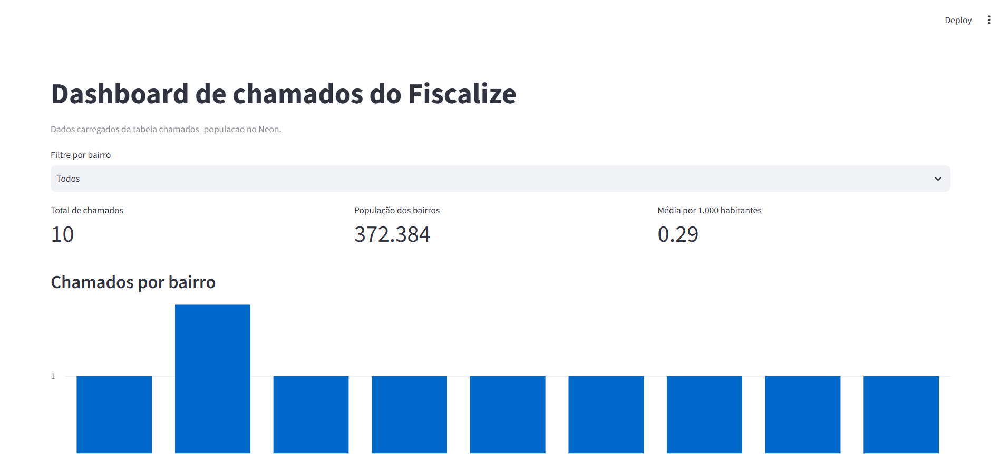
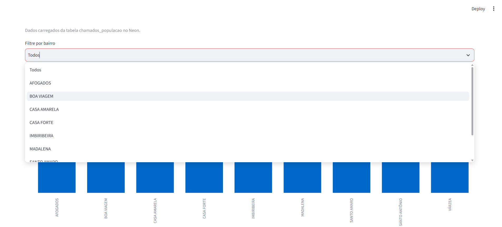
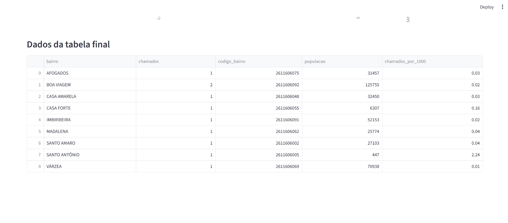

# ETL Fiscalize — População e Clima

<!-- Updated by AI. -->

ETLs desenvolvidas para enriquecer os dados de chamados urbanos do Fiscalize com fontes públicas externas: condições climáticas, obtidas pela Open-Meteo, e população por bairro, obtida do Censo Demográfico 2022 do IBGE.

Os dados brutos são armazenados no MongoDB (camada **bronze**), as tabelas normalizadas são gravadas no SQLite e no Neon (camada **silver**) e as tabelas agregadas consumidas pelo dashboard também ficam no SQLite e no Neon (camada **gold**). O projeto disponibiliza um dashboard em Streamlit com chamados por bairro e a relação entre clima e chamados por dia.

## Pré-requisitos

- Python 3.10 ou superior, compatível com as dependências do projeto.
- Acesso ao cluster MongoDB do projeto.
- Acesso ao banco PostgreSQL no Neon.
- Dependências listadas em `etl/requirements.txt`.
- Arquivo `etl/.env` configurado com as variáveis necessárias.

## Estrutura de pastas

```text
fiscalize-mobile/
├── dashboard/
│   └── app.py                       # Dashboard Streamlit conectado ao Neon
├── docs/
│   └── evidencias/
│       ├── dashboard_visao_geral.png
│       ├── dashboard_filtro_tabela.png
│       └── dashboard_dados_detalhados.png
└── etl/
    ├── data/
    │   └── chamados.json            # Fixture legado; não é usado pelo pipeline
    ├── notebooks/
    │   ├── clima.ipynb              # Rascunho exploratório do ETL de clima
    │   └── populacao.ipynb           # Rascunho exploratório do ETL de população
    ├── src/
    │   ├── config.py                # Centralização das configurações
    │   ├── chamados.py              # Leitura de `chamados_raw` e intervalo de datas
    │   ├── extract.py               # Extração de dados das fontes
    │   ├── load.py                  # Carga dos dados nos destinos
    │   ├── normalize.py             # Normalização de bairros para o padrão IBGE
    │   ├── seed_mongo.py            # Funções para popular as coleções brutas
    │   ├── sync_chamados.py         # Sync backend PostgreSQL → `chamados_raw`
    │   └── transform.py             # Camadas silver e gold (normalização e agregação)
    ├── run_etl.py                   # Ponto de entrada do pipeline
    ├── flow_etl.py                  # Orquestração do pipeline com Prefect
    ├── requirements.txt             # Dependências do ETL e dashboard
    ├── .env.example                 # Modelo de configuração sem credenciais reais
    ├── .env                         # Configurações reais, não versionadas
    └── README-ETL.md                # Documentação do ETL
```

Os notebooks em `etl/notebooks/` são materiais exploratórios. Eles não fazem parte do pipeline executável e não são chamados pelo ponto de entrada do ETL.

## Configuração do ambiente

Execute os comandos a seguir a partir da raiz do repositório, `fiscalize-mobile/`.

### 1. Criar e ativar o ambiente virtual

No Windows, utilizando PowerShell:

```powershell
python -m venv etl/.venv
.\etl\.venv\Scripts\Activate.ps1
```

Se o ambiente virtual já estiver criado e ativo, não é necessário recriá-lo.

No Linux ou macOS:

```bash
python3 -m venv etl/.venv
source etl/.venv/bin/activate
```

### 2. Instalar as dependências

Com o ambiente virtual ativado:

```bash
python -m pip install -r etl/requirements.txt
```

### 3. Configurar as variáveis de ambiente

O arquivo `etl/src/config.py` centraliza a leitura das configurações do projeto e disponibiliza os valores necessários aos demais módulos.

Entre as configurações estão:

- `MONGODB_URI`: conexão com o MongoDB.
- `DATABASE_URL`: conexão com o PostgreSQL no Neon.
- `BACKEND_DATABASE_URL`: conexão somente leitura com o PostgreSQL operacional do backend. Use o mesmo valor do `DATABASE_URL` de `backend/.env`. É obrigatória para o sync dos chamados.
- `MONGO_DATABASE`: nome do banco no MongoDB.
- `SQLITE_DATABASE`: caminho do banco SQLite.

Para configurar o ambiente:

1. Copie o arquivo de exemplo:

   ```powershell
   Copy-Item etl/.env.example etl/.env
   ```

2. Preencha `MONGODB_URI` com a connection string do cluster MongoDB Atlas do projeto.
3. Preencha `DATABASE_URL` com a connection string do banco PostgreSQL no Neon.
4. Preencha `BACKEND_DATABASE_URL` com a connection string do PostgreSQL operacional do backend (mesmo valor de `backend/.env`). Prefira um usuário com permissão apenas de leitura.
5. Confira as demais variáveis documentadas em `etl/.env.example` e ajuste-as conforme necessário.

**Importante:** nunca compartilhe ou versione o arquivo `etl/.env` com credenciais reais. Utilize o `.env.example` para documentar as variáveis necessárias sem expor senhas ou tokens.

O arquivo `config.py` é o ponto central de configuração, evitando que cada módulo precise carregar as variáveis de ambiente individualmente.

## Como executar o pipeline

O ponto de entrada do pipeline é `etl/run_etl.py`. A execução realiza as etapas de sincronização dos chamados, extração, transformação e carga dos dados de clima e população.

> **Importante:** o sync e o pipeline gravam em destinos diferentes. O comando `sync_chamados` atualiza apenas o MongoDB (`chamados_raw`). O Dashboard ETL do app lê a tabela final `chamados_populacao` no Neon, que só é atualizada quando o pipeline é executado. **Rodar somente o sync não altera o total exibido no app.**

### 1. Sincronizar os chamados do backend

O ETL não escreve no banco operacional. Os chamados chegam por um sync somente leitura do PostgreSQL do backend para a coleção `chamados_raw` do MongoDB:

```bash
cd etl
python3 -m src.sync_chamados
```

O sync é idempotente: usa o `id` do chamado como `_id`, atualiza registros existentes e remove de `chamados_raw` os chamados que não existem mais no backend. Rodar novamente não duplica dados. Ele também registra em log quantos chamados vieram sem bairro e sem coordenada válida.

> O comando de sync lê `BACKEND_DATABASE_URL`. Sem essa variável, ele falha com uma mensagem explícita.

### 2. Executar o pipeline completo

Com o ambiente virtual ativado, a partir da pasta `etl/`:

```bash
cd etl
python run_etl.py
```

No Windows/PowerShell, o comando é o mesmo: `python run_etl.py`.

O pipeline executa, nesta ordem:

1. **Bronze:** lê `chamados_raw` (sync do backend) e garante as cargas brutas de clima (`clima_raw`) e população (`populacao_ibge_raw`) no MongoDB.
2. **Silver:** monta `silver_chamado`, `silver_clima_diario` e `silver_bairro_populacao`.
3. **Gold:** gera `chamados_clima`, `chamados_populacao` e `chamados_clima_diario` exclusivamente a partir das tabelas silver.
4. **Load:** grava silver e gold no SQLite local e no Neon.

**Atenção:** a execução apaga e regrava as linhas das tabelas finais no Neon (sem `DROP TABLE`). Confirme as permissões do usuário configurado antes de executar em um ambiente compartilhado.

O pipeline utiliza as funções de extração, transformação e carga implementadas nos módulos de `etl/src/`.

A carga de clima é automática: o pipeline calcula o intervalo de datas coberto por `chamados_raw` (no fuso `America/Recife`) e consulta a Open-Meteo somente quando a série já carregada não cobre esse intervalo. A carga bruta de população continua sendo feita pelas funções de seed de `etl/src/seed_mongo.py`.

O fim da consulta climática é limitado à data atual de Recife. Assim, chamados
recentes podem ficar sem dados climáticos enquanto a Open-Meteo ainda não
disponibiliza o histórico; esses valores permanecem nulos e são preenchidos em
uma execução futura.

### 2.1 Atualizar apenas o Dashboard ETL (população)

Quando o objetivo for apenas refletir chamados novos no **Dashboard ETL do app**, execute somente a etapa de população:

```bash
cd etl
python -c "from run_etl import run_populacao; run_populacao()"
```

Essa etapa:

1. Lê a carga mais recente de `chamados_raw` no MongoDB.
2. Regrava `silver_chamado` e `silver_bairro_populacao`.
3. Agrega os chamados por bairro e regrava a gold `chamados_populacao` no SQLite local e no Neon.

É mais rápida que o pipeline completo e não consulta a API de clima. Ao final, o log deve exibir algo como:

```text
Carga mais recente de chamados_raw: 22 registros em ...
Camada silver de chamados montada: 22 registro(s), 0 sem bairro, 1 sem coordenada válida.
Gold chamados_populacao gerada com sucesso!
DataFrame carregado com sucesso no PostgreSQL: chamados_populacao
```

O número em `chamado(s) de entrada` deve ser igual ao total que o dashboard passará a exibir. Para conferir no app, puxe a tela do dashboard para baixo ou toque no ícone de refresh.

### 3. Ordem recomendada para reproduzir uma atualização

```bash
cd etl
python -m src.sync_chamados
python run_etl.py
```

Se a alteração for apenas em chamados e você não precisar atualizar clima, substitua o segundo comando pela etapa isolada de população mostrada em **2.1**.

## Histórico das cargas e camada bronze

A coleção `chamados_raw` é a entrada operacional do ETL. Ela é preenchida pelo sync a partir do PostgreSQL do backend e é atualizada de forma idempotente, com `synced_at` e `data_extracao` em cada documento. Os campos `latitude`/`longitude` acompanham `coordenada_valida`: chamados antigos com `(0, 0)` são tratados como ausência de coordenada, não como um ponto real.

As cargas brutas armazenadas no MongoDB recebem o campo `data_extracao`, que identifica o momento em que os dados foram coletados.

O processo de carga mantém os documentos antigos na coleção, em vez de apagá-los a cada nova extração. Na etapa de extração para transformação, são selecionados os documentos pertencentes à carga mais recente identificada por `data_extracao`.

Esse procedimento permite preservar o histórico das cargas brutas e utilizar a versão mais recente na transformação.

A seleção da última carga deve ser distinguida da atualização das tabelas finais: a preservação do histórico bruto não significa, por si só, que as tabelas finais sejam incrementais.

### Camadas silver e gold

| Camada | Onde fica | Tabelas | Papel |
|---|---|---|---|
| Bronze | MongoDB | `chamados_raw`, `clima_raw`, `populacao_ibge_raw` | Dados como vieram das fontes, com `data_extracao` |
| Silver | SQLite e Neon | `silver_chamado`, `silver_clima_diario`, `silver_bairro_populacao` | Dados normalizados, uma linha por entidade/dia/bairro |
| Gold | SQLite e Neon | `chamados_clima`, `chamados_populacao`, `chamados_clima_diario` | Dados agregados e cruzados para o dashboard |

`silver_chamado` já chega sem os chamados soft-deleted: o sync filtra `excluidoem IS NULL` no backend. A gold `chamados_clima_diario` é a tabela que efetivamente usa a série diária da Open-Meteo: cada linha traz data, temperatura média, precipitação e quantidade de chamados naquele dia.

O carregamento no Neon apaga as linhas da tabela e insere a nova carga na mesma transação. Isso evita `DROP TABLE`/`TRUNCATE`, que exigiriam ser proprietário da tabela.

### Integridade dos registros

A transformação deve considerar todos os itens relevantes recebidos das fontes, evitando índices fixos que descartem dados, como o uso indevido de `[0]` em listas que representam múltiplos registros.

Na transformação climática, as listas diárias de datas, temperaturas e precipitações são organizadas em registros que podem ser relacionados às datas dos chamados.

Na transformação de população, os registros são filtrados para Recife, os nomes dos bairros são padronizados e os dados são agregados para permitir o cruzamento com os chamados. A normalização usa a mesma regra do backend (maiúsculas, sem acentos e com espaços colapsados) para que `Boa Viagem`, `boa viagem` e `BOA VIAGEM` caiam no mesmo bairro. Chamados sem bairro são mantidos no agregado como `NAO INFORMADO`.

As contagens das diferentes etapas não precisam ser iguais, pois as transformações podem filtrar ou agregar registros. Para validar a integridade, compare as quantidades considerando a finalidade de cada etapa.

## Tratamento de dados ausentes

Os dados de origem podem representar valores ausentes por meio de campos vazios, `-`, `N/A`, `NA` ou `...`.

No ETL de população, esses marcadores são tratados como valores ausentes. Valores numéricos inválidos são convertidos em nulos (`NaN` no DataFrame), em vez de serem substituídos automaticamente por zero.

Na fonte climática, uma precipitação igual a `0` é um valor válido, pois representa ausência de chuva no período. Esse valor deve ser preservado, enquanto valores realmente ausentes devem continuar nulos.

Essa distinção evita que a ausência de informação seja confundida com um valor numérico real.

## Dashboard do Fiscalize

O projeto possui um dashboard desenvolvido com **Streamlit**, que consulta as tabelas gold `chamados_populacao` e `chamados_clima_diario`, armazenadas no PostgreSQL do Neon.

O app mobile também possui a tela **Dashboard ETL**, que consome o endpoint `/dashboard/etl/population` do backend. Esse endpoint lê a mesma tabela `chamados_populacao` no Neon.

Nos dois casos, a tabela precisa ser regravada pela etapa de população do ETL. Apenas rodar o sync de chamados não atualiza esses dashboards.

A aplicação apresenta indicadores e visualizações para facilitar a análise da distribuição dos chamados por bairro.

### Funcionalidades

- **Filtro por bairro:** permite selecionar um bairro específico ou visualizar todos os bairros disponíveis.
- **Total de chamados:** apresenta a soma dos chamados considerados após a aplicação do filtro.
- **População dos bairros:** apresenta a população associada aos registros exibidos.
- **Média por 1.000 habitantes:** apresenta a média do indicador `chamados_por_1000` nos registros considerados.
- **Gráfico de barras:** mostra a quantidade de chamados por bairro.
- **Tabela de dados:** apresenta os registros utilizados nas visualizações.
- **Clima x chamados por dia:** dois gráficos de eixo duplo cruzam a quantidade diária de chamados com a precipitação e com a temperatura média da Open-Meteo.
- **Indicadores climáticos:** chamados no período, precipitação acumulada e temperatura média.
- **Tabela diária de clima:** apresenta data, temperatura, precipitação e chamados de `chamados_clima_diario`.

Os indicadores e as visualizações de bairro são atualizados conforme o filtro selecionado. O clima é da cidade do Recife e não muda com o filtro de bairro.

### Executar o dashboard

Com o ambiente virtual ativado e as dependências instaladas, execute na raiz do repositório:

```powershell
python -m streamlit run dashboard/app.py
```

O Streamlit disponibilizará o dashboard no navegador, normalmente em:

```text
http://localhost:8501
```

A aplicação depende de uma conexão válida com o Neon e da existência das tabelas `chamados_populacao` e `chamados_clima_diario`.

## Evidências de execução

### 1. Visão geral do dashboard



### 2. Filtro por bairro e tabela



### 3. Dados detalhados



## ETL de Clima

### Objetivo

Relacionar os chamados urbanos às condições climáticas do período em que foram registrados, permitindo analisar possíveis relações entre ocorrências urbanas e fatores como chuva e temperatura.

### Fonte

**Open-Meteo** — API pública de dados meteorológicos.

- Documentação: https://open-meteo.com/en/docs
- API de dados históricos: https://archive-api.open-meteo.com/v1/archive

### Etapas

1. **Sync:** copia os chamados do PostgreSQL do backend para `chamados_raw` (executado antes do pipeline).
2. **Extract:** consulta os dados climáticos da Open-Meteo apenas quando a série carregada não cobre o intervalo real dos chamados.
3. **Silver:** organiza datas, temperaturas e precipitações em `silver_clima_diario`, uma linha por dia.
4. **Gold:** cruza `silver_chamado` com `silver_clima_diario` pela data local de Recife, gerando `chamados_clima`, e agrega os chamados por dia em `chamados_clima_diario`.
5. **Load:** grava o bruto no MongoDB e as tabelas silver/gold no SQLite e no Neon.

### Modelo conceitual da tabela final

| Chamado | Categoria | Data | Precipitação | Temperatura |
|---|---|---|---:|---:|
| 001 | Buraco | ... | 12,4 mm | 26,8 °C |
| 002 | Buraco | ... | 18,2 mm | 25,9 °C |
| 003 | Sinalização | ... | 0 mm | 29,1 °C |

Os valores da tabela são exemplos ilustrativos do formato esperado, não necessariamente registros atuais do banco.

### Destinos

- MongoDB: coleção `clima_raw`, com dados brutos.
- Silver: `silver_clima_diario` no SQLite e no Neon.
- Gold: `chamados_clima` e `chamados_clima_diario` no SQLite e no Neon.

### Modelo conceitual da tabela diária

| Data | Temperatura | Precipitação | Chamados |
|---|---:|---:|---:|
| 2026-11-04 | 27,9 °C | 0,6 mm | 0 |
| 2026-11-05 | 28,0 °C | 0,0 mm | 1 |
| 2026-11-07 | 28,2 °C | 1,0 mm | 20 |

Os valores ilustram o formato da tabela `chamados_clima_diario`, consumida pelos gráficos de clima do dashboard.

## ETL de População

### Objetivo

Relacionar a quantidade de chamados urbanos à população de cada bairro, permitindo comparar os bairros considerando seu tamanho populacional.

A principal métrica gerada é a quantidade de chamados para cada 1.000 habitantes.

### Fonte

**IBGE — Censo Demográfico 2022**, utilizando os dados de população por bairro.

- Agregados por bairro: https://ftp.ibge.gov.br/Censos/Censo_Demografico_2022/Agregados_por_Setores_Censitarios/Agregados_por_Bairro_csv/
- Arquivo utilizado: `Agregados_por_bairros_demografia_BR.zip`

### Etapas

1. **Sync:** garante que `chamados_raw` contém os chamados atuais do backend.
2. **Extract:** obtém os dados de população do IBGE.
3. **Silver:** seleciona as colunas necessárias, filtra os bairros de Recife e padroniza os nomes em `silver_bairro_populacao`.
4. **Gold:** agrega `silver_chamado` por bairro e cruza com `silver_bairro_populacao` para gerar `chamados_populacao`.
5. **Load:** grava os dados brutos e as tabelas silver/gold nos destinos configurados.

### Modelo conceitual da tabela final

| Bairro | Chamados | População | Chamados por 1.000 habitantes |
|---|---:|---:|---:|
| BOA VIAGEM | 2 | 125755 | 0,02 |
| IMBIRIBEIRA | 1 | ... | ... |
| AFOGADOS | 1 | ... | ... |

Os valores ilustram o formato da tabela e não substituem a consulta aos dados atuais.

### Destinos

- MongoDB: coleção `populacao_ibge_raw`, com dados brutos.
- Silver: `silver_bairro_populacao` no SQLite e no Neon.
- Gold: `chamados_populacao` no SQLite e no Neon, utilizada pelos dashboards.

## Orquestração com Prefect

O projeto também contém o arquivo `etl/flow_etl.py`, responsável por organizar as etapas da pipeline em tarefas e executá-las na ordem definida pelas dependências.

O fluxo executa, nesta ordem:

1. `Sincronizar chamados do backend`: `SyncChamados.run()` lê o PostgreSQL do backend e atualiza `chamados_raw`.
2. `Ler chamados`: lê `chamados_raw` e calcula o intervalo de datas necessário.
3. `Garantir clima no intervalo`: consulta a Open-Meteo somente se a série climática existente não cobrir o intervalo.
4. `Garantir população do IBGE`: baixa a população apenas quando `populacao_ibge_raw` estiver vazia.
5. `Construir camada silver`: monta `silver_chamado`, `silver_clima_diario` e `silver_bairro_populacao`.
6. `Carregar no SQLite` e `Carregar no Neon` da silver.
7. `Construir camada gold`: gera `chamados_clima`, `chamados_populacao` e `chamados_clima_diario` a partir da silver.
8. `Carregar no SQLite` e `Carregar no Neon` da gold.

Para executar o fluxo, a partir da raiz do repositório:

```powershell
python etl/flow_etl.py
```

A execução requer as dependências instaladas, as variáveis de ambiente configuradas (incluindo `BACKEND_DATABASE_URL`) e acesso às fontes e aos destinos utilizados pelo pipeline.

Como o fluxo pode realizar cargas no Neon, verifique as permissões do banco antes de executá-lo em um ambiente compartilhado.

## Troubleshooting

### Dashboard ETL mostra um total menor que o `sync_chamados`

Sintoma: o comando de sync informa, por exemplo, `89 gravado(s)`, mas o Dashboard ETL do app continua mostrando `88`.

Causa: o sync grava apenas no MongoDB (`chamados_raw`). O dashboard lê `chamados_populacao` no Neon, que ainda contém a carga anterior do ETL.

Solução: execute a etapa de população para regravar a tabela final:

```bash
cd etl
python -c "from run_etl import run_populacao; run_populacao()"
```

Depois, no app, puxe a tela do dashboard para baixo ou toque no ícone de refresh. Para atualizar também os dados climáticos, use o pipeline completo: `python run_etl.py`.

### `ValueError` ao abrir `chamados_raw`

A coleção `chamados_raw` está vazia. Execute o sync antes do ETL:

```bash
cd etl
python -m src.sync_chamados
```

### `BACKEND_DATABASE_URL não foi encontrada`

Copie o valor de `DATABASE_URL` de `backend/.env` para `BACKEND_DATABASE_URL` em `etl/.env`. O `DATABASE_URL` do ETL continua apontando para o Neon e não é usado pelo sync.

### `ModuleNotFoundError: No module named 'src'`

Confirme que o ambiente virtual está ativado, que as dependências foram instaladas e que os comandos estão sendo executados a partir da raiz do repositório conforme as instruções.

### Erro de conexão com o MongoDB

Confira se `etl/.env` existe e se `MONGODB_URI` contém uma connection string válida. Verifique também o acesso ao cluster MongoDB Atlas e as permissões de rede.

### Erro ao conectar ao Neon

Confira se `DATABASE_URL` está configurada corretamente no arquivo `etl/.env` e se o banco está acessível. Não compartilhe a connection string ou a senha ao solicitar ajuda.

### Dados brutos sem `data_extracao`

Se a coleção possuir apenas cargas antigas sem o campo `data_extracao`, pode ser necessária uma nova carga bruta para gerar documentos com esse marcador. Confirme o comportamento da função de seed antes de executá-la, pois ela pode inserir novos documentos na coleção.

### Erro `must be owner of table` ao carregar no Neon

O carregamento atual **não usa mais** `if_exists="replace"`. Para cada tabela, o ETL executa `DELETE` das linhas e insere a nova carga na mesma transação. Isso funciona com usuários que têm `SELECT`/`INSERT`/`DELETE`, mesmo sem serem proprietários da tabela.

Se ainda aparecer erro de permissão:

1. Confirme que o usuário de `DATABASE_URL` tem `INSERT` e `DELETE` na tabela.
2. Tabelas novas (`silver_*`, `chamados_clima_diario`) são criadas pelo próprio usuário do ETL.
3. Para tabelas antigas criadas por outro papel (por exemplo, `neondb_owner`), peça ao responsável pelo banco para conceder `INSERT` e `DELETE` ao usuário do ETL. `TRUNCATE` não é necessário.
