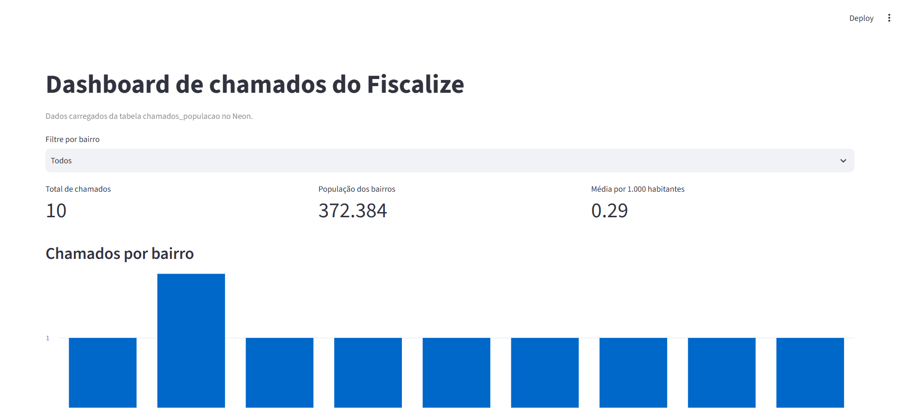
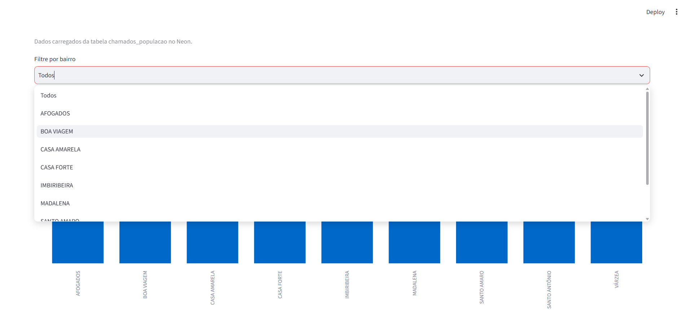
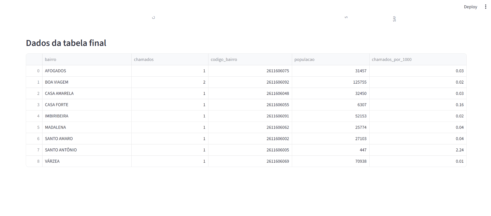

# ETL Fiscalize — População e Clima

ETLs desenvolvidas para enriquecer os dados de chamados urbanos do Fiscalize com fontes públicas externas: condições climáticas, obtidas pela Open-Meteo, e população por bairro, obtida do Censo Demográfico 2022 do IBGE.

Os dados brutos são armazenados no MongoDB, enquanto os dados transformados são carregados no SQLite e no Neon (PostgreSQL). O projeto também disponibiliza um dashboard desenvolvido com Streamlit para visualizar os dados consolidados de chamados por bairro.

## Pré-requisitos

- Python 3.10 ou superior, compatível com as dependências do projeto.
- Acesso ao cluster MongoDB do projeto.
- Acesso ao banco PostgreSQL no Neon.
- Dependências listadas em `etl/requirements.txt`.
- Arquivo `etl/.env` configurado com as variáveis necessárias.

## Estrutura de pastas

```text
fiscalize-mobile/
├── dashboard/
│   └── app.py                       # Dashboard Streamlit conectado ao Neon
├── docs/
│   └── evidencias/
│       ├── dashboard_visao_geral.png
│       ├── dashboard_filtro_tabela.png
│       └── dashboard_dados_detalhados.png
└── etl/
    ├── data/
    │   └── chamados.json            # Chamados fictícios usados como entrada
    ├── notebooks/
    │   ├── clima.ipynb              # Rascunho exploratório do ETL de clima
    │   └── populacao.ipynb           # Rascunho exploratório do ETL de população
    ├── src/
    │   ├── config.py                # Centralização das configurações
    │   ├── extract.py               # Extração de dados das fontes
    │   ├── transform.py             # Transformação e cruzamento dos dados
    │   ├── load.py                  # Carga dos dados nos destinos
    │   └── seed_mongo.py            # Funções para popular as coleções brutas
    ├── run_etl.py                   # Ponto de entrada do pipeline
    ├── flow_etl.py                  # Orquestração do pipeline com Prefect
    ├── requirements.txt             # Dependências do ETL e dashboard
    ├── .env.example                 # Modelo de configuração sem credenciais reais
    ├── .env                         # Configurações reais, não versionadas
    └── README-ETL.md                # Documentação do ETL
```

Os notebooks em `etl/notebooks/` são materiais exploratórios. Eles não fazem parte do pipeline executável e não são chamados pelo ponto de entrada do ETL.

## Configuração do ambiente

Execute os comandos a seguir a partir da raiz do repositório, `fiscalize-mobile/`.

### 1. Criar e ativar o ambiente virtual

No Windows, utilizando PowerShell:

```powershell
python -m venv etl/.venv
.\etl\.venv\Scripts\Activate.ps1
```

Se o ambiente virtual já estiver criado e ativo, não é necessário recriá-lo.

No Linux ou macOS:

```bash
python3 -m venv etl/.venv
source etl/.venv/bin/activate
```

### 2. Instalar as dependências

Com o ambiente virtual ativado:

```bash
python -m pip install -r etl/requirements.txt
```

### 3. Configurar as variáveis de ambiente

O arquivo `etl/src/config.py` centraliza a leitura das configurações do projeto e disponibiliza os valores necessários aos demais módulos.

Entre as configurações estão:

- `MONGODB_URI`: conexão com o MongoDB.
- `DATABASE_URL`: conexão com o PostgreSQL no Neon.
- `MONGO_DATABASE`: nome do banco no MongoDB.
- `SQLITE_DATABASE`: caminho do banco SQLite.

Para configurar o ambiente:

1. Copie o arquivo de exemplo:

   ```powershell
   Copy-Item etl/.env.example etl/.env
   ```

2. Preencha `MONGODB_URI` com a connection string do cluster MongoDB Atlas do projeto.
3. Preencha `DATABASE_URL` com a connection string do banco PostgreSQL no Neon.
4. Confira as demais variáveis documentadas em `etl/.env.example` e ajuste-as conforme necessário.

**Importante:** nunca compartilhe ou versione o arquivo `etl/.env` com credenciais reais. Utilize o `.env.example` para documentar as variáveis necessárias sem expor senhas ou tokens.

O arquivo `config.py` é o ponto central de configuração, evitando que cada módulo precise carregar as variáveis de ambiente individualmente.

## Como executar o pipeline

O ponto de entrada do pipeline é `etl/run_etl.py`. A execução realiza as etapas de extração, transformação e carga dos dados de clima e população.

Na raiz do repositório, execute:

```powershell
python etl/run_etl.py
```

**Atenção:** a execução pode atualizar ou recriar tabelas finais no Neon. Antes de executar o pipeline novamente em um ambiente compartilhado, confirme as permissões do usuário configurado e as regras de carga descritas neste documento.

O pipeline utiliza as funções de extração, transformação e carga implementadas nos módulos de `etl/src/`.

Uma carga inicial das fontes brutas pode exigir a execução das funções de seed correspondentes, conforme a implementação de `etl/src/seed_mongo.py`.

## Histórico das cargas e camada bronze

As cargas brutas armazenadas no MongoDB recebem o campo `data_extracao`, que identifica o momento em que os dados foram coletados.

O processo de carga mantém os documentos antigos na coleção, em vez de apagá-los a cada nova extração. Na etapa de extração para transformação, são selecionados os documentos pertencentes à carga mais recente identificada por `data_extracao`.

Esse procedimento permite preservar o histórico das cargas brutas e utilizar a versão mais recente na transformação.

A seleção da última carga deve ser distinguida da atualização das tabelas finais: a preservação do histórico bruto não significa, por si só, que as tabelas finais sejam incrementais.

### Integridade dos registros

A transformação deve considerar todos os itens relevantes recebidos das fontes, evitando índices fixos que descartem dados, como o uso indevido de `[0]` em listas que representam múltiplos registros.

Na transformação climática, as listas diárias de datas, temperaturas e precipitações são organizadas em registros que podem ser relacionados às datas dos chamados.

Na transformação de população, os registros são filtrados para Recife, os nomes dos bairros são padronizados e os dados são agregados para permitir o cruzamento com os chamados.

As contagens das diferentes etapas não precisam ser iguais, pois as transformações podem filtrar ou agregar registros. Para validar a integridade, compare as quantidades considerando a finalidade de cada etapa.

## Tratamento de dados ausentes

Os dados de origem podem representar valores ausentes por meio de campos vazios, `-`, `N/A`, `NA` ou `...`.

No ETL de população, esses marcadores são tratados como valores ausentes. Valores numéricos inválidos são convertidos em nulos (`NaN` no DataFrame), em vez de serem substituídos automaticamente por zero.

Na fonte climática, uma precipitação igual a `0` é um valor válido, pois representa ausência de chuva no período. Esse valor deve ser preservado, enquanto valores realmente ausentes devem continuar nulos.

Essa distinção evita que a ausência de informação seja confundida com um valor numérico real.

## Dashboard do Fiscalize

O projeto possui um dashboard desenvolvido com **Streamlit**, que consulta a tabela final `chamados_populacao`, armazenada no PostgreSQL do Neon.

A aplicação apresenta indicadores e visualizações para facilitar a análise da distribuição dos chamados por bairro.

### Funcionalidades

- **Filtro por bairro:** permite selecionar um bairro específico ou visualizar todos os bairros disponíveis.
- **Total de chamados:** apresenta a soma dos chamados considerados após a aplicação do filtro.
- **População dos bairros:** apresenta a população associada aos registros exibidos.
- **Média por 1.000 habitantes:** apresenta a média do indicador `chamados_por_1000` nos registros considerados.
- **Gráfico de barras:** mostra a quantidade de chamados por bairro.
- **Tabela de dados:** apresenta os registros utilizados nas visualizações.

Os indicadores e as visualizações são atualizados conforme o filtro selecionado.

### Executar o dashboard

Com o ambiente virtual ativado e as dependências instaladas, execute na raiz do repositório:

```powershell
python -m streamlit run dashboard/app.py
```

O Streamlit disponibilizará o dashboard no navegador, normalmente em:

```text
http://localhost:8501
```

A aplicação depende de uma conexão válida com o Neon e da existência da tabela `chamados_populacao`.

## Evidências de execução

### 1. Visão geral do dashboard



### 2. Filtro por bairro e tabela



### 3. Dados detalhados



## ETL de Clima

### Objetivo

Relacionar os chamados urbanos às condições climáticas do período em que foram registrados, permitindo analisar possíveis relações entre ocorrências urbanas e fatores como chuva e temperatura.

### Fonte

**Open-Meteo** — API pública de dados meteorológicos.

- Documentação: https://open-meteo.com/en/docs
- API de dados históricos: https://archive-api.open-meteo.com/v1/archive

### Etapas

1. **Extract:** consulta os dados climáticos da fonte.
2. **Transform:** organiza as datas, temperaturas e precipitações em registros estruturados.
3. **Merge:** relaciona os dados climáticos aos chamados por data.
4. **Load:** grava os dados brutos no MongoDB e os dados cruzados nos destinos configurados.

### Modelo conceitual da tabela final

| Chamado | Categoria | Data | Precipitação | Temperatura |
|---|---|---|---:|---:|
| 001 | Buraco | ... | 12,4 mm | 26,8 °C |
| 002 | Buraco | ... | 18,2 mm | 25,9 °C |
| 003 | Sinalização | ... | 0 mm | 29,1 °C |

Os valores da tabela são exemplos ilustrativos do formato esperado, não necessariamente registros atuais do banco.

### Destinos

- MongoDB: coleção `clima_raw`, com dados brutos.
- SQLite: tabela `chamados_clima`.
- Neon: tabela `chamados_clima`, quando a carga no PostgreSQL é executada com sucesso.

## ETL de População

### Objetivo

Relacionar a quantidade de chamados urbanos à população de cada bairro, permitindo comparar os bairros considerando seu tamanho populacional.

A principal métrica gerada é a quantidade de chamados para cada 1.000 habitantes.

### Fonte

**IBGE — Censo Demográfico 2022**, utilizando os dados de população por bairro.

- Agregados por bairro: https://ftp.ibge.gov.br/Censos/Censo_Demografico_2022/Agregados_por_Setores_Censitarios/Agregados_por_Bairro_csv/
- Arquivo utilizado: `Agregados_por_bairros_demografia_BR.zip`

### Etapas

1. **Extract:** obtém os dados de população do IBGE.
2. **Transform:** seleciona as colunas necessárias, filtra os bairros de Recife e padroniza os nomes.
3. **Merge:** relaciona os chamados à população dos bairros.
4. **Load:** grava os dados brutos e os dados consolidados nos destinos configurados.

### Modelo conceitual da tabela final

| Bairro | Chamados | População | Chamados por 1.000 habitantes |
|---|---:|---:|---:|
| BOA VIAGEM | 2 | 125755 | 0,02 |
| IMBIRIBEIRA | 1 | ... | ... |
| AFOGADOS | 1 | ... | ... |

Os valores ilustram o formato da tabela e não substituem a consulta aos dados atuais.

### Destinos

- MongoDB: coleção `populacao_ibge_raw`, com dados brutos.
- SQLite: tabela `chamados_populacao`.
- Neon: tabela `chamados_populacao`, utilizada pelo dashboard.

## Orquestração com Prefect

O projeto também contém o arquivo `etl/flow_etl.py`, responsável por organizar as etapas da pipeline em tarefas e executá-las na ordem definida pelas dependências.

Para executar o fluxo, a partir da raiz do repositório:

```powershell
python etl/flow_etl.py
```

A execução requer as dependências instaladas, as variáveis de ambiente configuradas e acesso às fontes e aos destinos utilizados pelo pipeline.

Como o fluxo pode realizar cargas no Neon, verifique as permissões do banco antes de executá-lo em um ambiente compartilhado.

## Troubleshooting

### `FileNotFoundError` ao abrir `chamados.json`

Confira se o arquivo existe em `etl/data/chamados.json` e execute os comandos a partir da raiz do repositório.

### `ModuleNotFoundError: No module named 'src'`

Confirme que o ambiente virtual está ativado, que as dependências foram instaladas e que os comandos estão sendo executados a partir da raiz do repositório conforme as instruções.

### Erro de conexão com o MongoDB

Confira se `etl/.env` existe e se `MONGODB_URI` contém uma connection string válida. Verifique também o acesso ao cluster MongoDB Atlas e as permissões de rede.

### Erro ao conectar ao Neon

Confira se `DATABASE_URL` está configurada corretamente no arquivo `etl/.env` e se o banco está acessível. Não compartilhe a connection string ou a senha ao solicitar ajuda.

### Dados brutos sem `data_extracao`

Se a coleção possuir apenas cargas antigas sem o campo `data_extracao`, pode ser necessária uma nova carga bruta para gerar documentos com esse marcador. Confirme o comportamento da função de seed antes de executá-la, pois ela pode inserir novos documentos na coleção.

### Erro `must be owner of table` ao carregar no Neon

O carregamento atual utiliza `if_exists="replace"` para recriar tabelas finais. Essa operação pode exigir que o usuário conectado seja proprietário das tabelas.

Foi registrado anteriormente um erro de permissão na tabela `chamados_clima`: o usuário conectado era `time_desenvolvimento`, enquanto o proprietário da tabela era `neondb_owner`.

Para resolver o problema, é necessário utilizar uma conexão com as permissões adequadas ou solicitar ao responsável pelo banco que ajuste a propriedade e as permissões das tabelas.

Até que isso seja resolvido, não considere uma execução do pipeline concluída com sucesso apenas porque a conexão com o Neon foi estabelecida.
